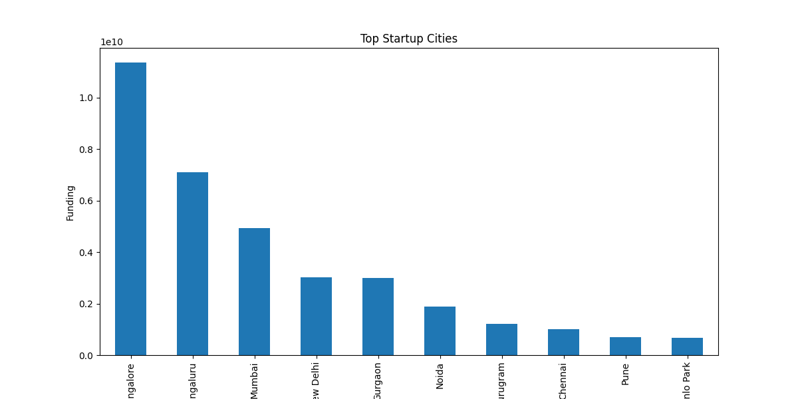
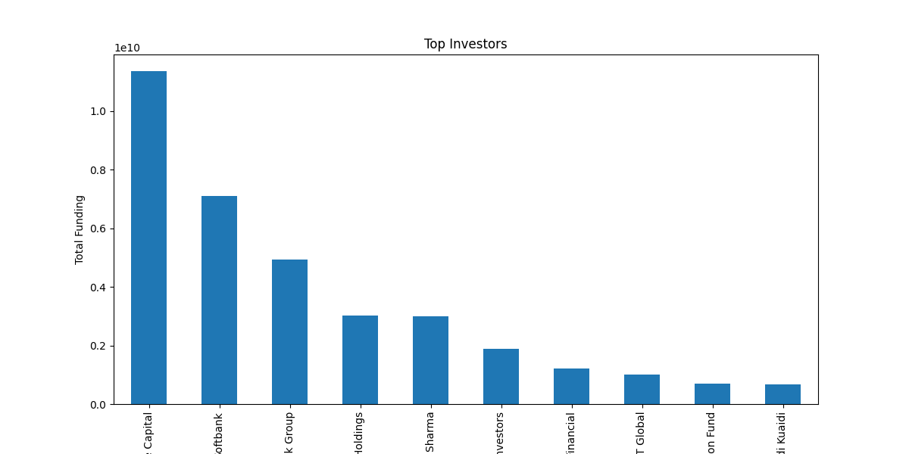
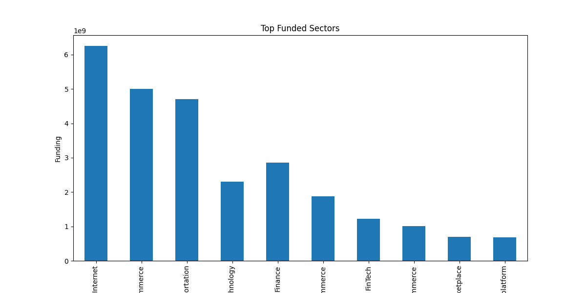
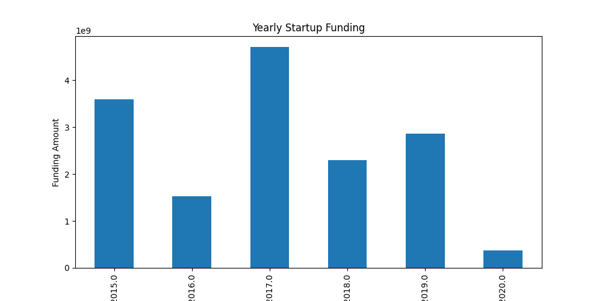

# Startup Funding Analysis

A Python-based exploratory data analysis project examining historical funding activity across India's startup ecosystem. It cleans and enriches raw funding records, identifies sector and city trends, evaluates investor activity, and creates publication-ready visualizations.

[](https://www.python.org/)
[](https://pandas.pydata.org/)
[](https://numpy.org/)
[](https://matplotlib.org/)

## Overview

This project explores how startup funding has evolved over time and where investment has been concentrated in India. The analysis transforms a Kaggle funding dataset into a cleaned CSV and produces charts covering sectors, cities, investors, and yearly funding patterns.

### Key questions answered

- Which sectors received the most funding?
- Which cities attracted the highest investment?
- Who were the most active investors?
- How did startup funding change from year to year?
- How can raw funding values be standardized for reliable analysis?

## Visualizations

<table>
  <tr>
    <td align="center"><strong>Top Startup Cities</strong><br></td>
    <td align="center"><strong>Top Investors</strong><br></td>
  </tr>
  <tr>
    <td align="center"><strong>Top Funded Sectors</strong><br></td>
    <td align="center"><strong>Yearly Funding Trends</strong><br></td>
  </tr>
</table>

## Features

- Removes duplicate records from the source dataset.
- Standardizes column names and whitespace.
- Converts date fields into a usable datetime format.
- Extracts year-level values for trend analysis.
- Cleans funding amounts, including commas and disclosed-value markers.
- Converts funding values to numeric form and excludes missing amounts.
- Groups and ranks the top sectors, cities, and investors.
- Generates high-resolution PNG charts automatically.
- Produces a cleaned CSV for reuse in dashboards or further SQL analysis.

## Dataset

The project uses the **Indian Startup Funding** dataset published on Kaggle:

- Dataset: [Indian Startup Funding](https://www.kaggle.com/datasets/sudalairajkumar/indian-startup-funding)
- Raw file: [`data/startup_funding.csv`](data/startup_funding.csv)
- Cleaned output: [`data/cleaned_startup_funding.csv`](data/cleaned_startup_funding.csv)

The source data includes startup names, industry verticals, investor names, funding amounts, cities, and funding dates.

## Technology Stack

| Category | Technologies |
| --- | --- |
| Language | Python |
| Data processing | Pandas, NumPy |
| Visualization | Matplotlib |
| Analysis | SQL |
| Development | VS Code, Git, GitHub |

## Project Structure

```text
startup_pred/
├── data/
│   ├── startup_funding.csv
│   └── cleaned_startup_funding.csv
├── sql/
│   ├── investors.sql
│   ├── top_cities.sql
│   ├── top_sectors.sql
│   └── yearly_fund.sql
├── visuals/
│   ├── top_cities.png
│   ├── top_investors.png
│   ├── top_sectors.png
│   └── yearly_funding.png
├── analysis.py
├── requirements.txt
└── README.md
```

## Getting Started

### Prerequisites

- Python 3.9 or newer
- `pip`
- A virtual environment is recommended

### Installation

```bash
# Clone the repository
git clone https://github.com/sudeep-06/startup_pred.git
cd startup_pred

# Create and activate a virtual environment
python -m venv venv

# Windows
venv\Scripts\activate

# macOS / Linux
source venv/bin/activate

# Install dependencies
pip install -r requirements.txt
```

### Run the Analysis

Execute the script from the repository root:

```bash
python analysis.py
```

The script reads `data/startup_funding.csv`, prints summary results and rankings to the terminal, saves charts in `visuals/`, and creates `data/cleaned_startup_funding.csv`.

## SQL Analysis

The `sql/` directory contains focused queries for investigating the cleaned dataset:

- [`investors.sql`](sql/investors.sql) — investor activity analysis
- [`top_cities.sql`](sql/top_cities.sql) — city-level funding distribution
- [`top_sectors.sql`](sql/top_sectors.sql) — sector-level funding comparison
- [`yearly_fund.sql`](sql/yearly_fund.sql) — yearly funding trends

## Methodology

1. Load the raw CSV into a Pandas DataFrame.
2. Remove duplicate records and normalize column names.
3. Parse dates and derive the funding year.
4. Remove formatting characters from funding amounts and convert values to numeric form.
5. Drop records with unavailable funding amounts.
6. Group funding data by sector, city, investor, and year.
7. Rank the top ten categories and export visual summaries.

## Future Enhancements

- Build an interactive Streamlit or Power BI dashboard.
- Add automated missing-data and anomaly reports.
- Include year-over-year growth metrics.
- Develop geographic funding maps.
- Create an investor–startup network analysis.
- Add funding prediction and forecasting models.
- Automate dataset ingestion and refreshes.

## Contributing

Contributions are welcome. To contribute:

1. Fork the repository.
2. Create a feature branch.
3. Commit your changes with clear messages.
4. Open a pull request describing the improvement.

Please keep generated data and image changes intentional and reproducible.

## License

This repository does not currently specify an open-source license.

## Author

**Sudeep**  
Student • Data Enthusiast • Aspiring Founder

GitHub: [@sudeep-06](https://github.com/sudeep-06)

---

Built to explore India's startup investment landscape through data analytics and visualization.
